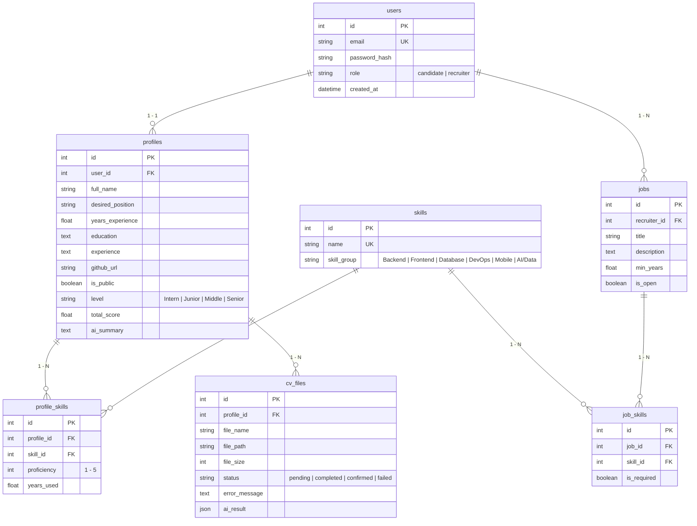

# BẢN CẬP NHẬT ĐỒNG BỘ TÀI LIỆU YÊU CẦU PHẦN MỀM (SRS) VÀ THIẾT KẾ HỆ THỐNG [TL-02]

**Dự án:** IT Talent AI Profile (Nhóm 10)  
**Người thực hiện:** Võ Chí Đức (Leader)  
**Mã Task:** TL-02 | **Môn học:** Thực tập doanh nghiệp  
**Phiên bản:** **v2.0 (Final Production Release)** | **Ngày cập nhật:** 24/11/2026  
**Mục tiêu:** Đồng bộ 100% giữa tài liệu thiết kế lý thuyết và mã nguồn hệ thống thực tế đã triển khai  

---

### 1. NHẬT KÝ THAY ĐỔI VÀ ĐỒNG BỘ PHIÊN BẢN (VERSION REVISION HISTORY)

| Phiên bản | Ngày | Người thực hiện | Tóm tắt các thay đổi đồng bộ chính |
|:---:|:---:|:---:|:---|
| **v1.0** | 03/11/2026 | Nhóm 10 | Bản đặc tả thiết kế kiến trúc sơ khởi ban đầu |
| **v1.5** | 14/11/2026 | Võ Chí Đức | Cập nhật cấu trúc 7 bảng CSDL MySQL, chuẩn hóa mô hình phân quyền JWT và thuật toán tính điểm |
| **v2.0** | 24/11/2026 | Võ Chí Đức | **Bản phát hành chính thức:** Cập nhật trọn vẹn 24 API endpoints, công thức đối sánh matching đa tiêu chí, giao diện 3D Glassmorphism, xử lý streaming CV và kịch bản phân quyền chi tiết |

---

### 2. CẬP NHẬT KIẾN TRÚC CƠ SỞ DỮ LIỆU THỰC TẾ (DATABASE SCHEMA V2.0)

Cơ sở dữ liệu MySQL `it_talent_ai` gồm **7 bảng quan hệ** với khóa ngoại và ràng buộc toàn vẹn `ON DELETE CASCADE`:

#### Những điểm cải tiến so với thiết kế ban đầu:
1. Trường `years_experience` và `years_used` được chuyển từ kiểu số nguyên sang kiểu `FLOAT` để phản ánh chính xác số năm kinh nghiệm thực tế (ví dụ: `1.5` năm, `3.5` năm).
2. Tích hợp chỉ mục tìm kiếm tối ưu: `idx_profile_skills_lookup` trên `(skill_id, profile_id)`, `idx_job_skills_lookup` trên `(job_id, skill_id)` và `idx_profiles_public_score` trên `(is_public, total_score)`.
3. Bổ sung cơ chế tự động dọn dẹp file CV vật lý mồ côi khi người dùng gọi API xóa tài khoản (`DELETE /profiles/me`).

---

### 3. CẬP NHẬT CÔNG THỨC TÍNH ĐIỂM VÀ ĐỐI SÁNH THỰC TẾ

#### 3.1. Công thức đánh giá năng lực ứng viên (Evaluation Module)
* **Điểm từng kỹ năng:**
  $$\text{Score}_{\text{skill}} = \min\Big(\text{proficiency} \times 12 + \min(\text{years\_used}, 5.0) \times 8, \; 100\Big)$$
  *(Trong đó mức thành thạo đóng góp 60%, số năm kinh nghiệm đóng góp 40%, giới hạn trần 100 điểm).*
* **Điểm nhóm chuyên môn:** Trung bình cộng điểm số của các kỹ năng thuộc cùng nhóm.
* **Điểm tổng hợp:** Trung bình cộng điểm số của các nhóm chuyên môn đã có kỹ năng.
* **Quy tắc xếp cấp độ (Career Progression):**
  * **Senior:** $\text{years\_experience} \ge 5.0$ VÀ $\text{total\_score} \ge 75.0$
  * **Middle:** $\text{years\_experience} \ge 2.0$ VÀ $\text{total\_score} \ge 55.0$
  * **Junior:** $\text{years\_experience} \ge 1.0$ VÀ $\text{total\_score} \ge 40.0$
  * **Intern:** Các trường hợp còn lại.

#### 3.2. Thuật toán đối sánh và xếp hạng ứng viên theo JD (Matching Module)
* **Trọng số phân bổ:**
  * **60%** Độ phủ kỹ năng bắt buộc (`is_required = True`).
  * **20%** Độ phủ kỹ năng ưu tiên (`is_required = False`).
  * **20%** Điểm kinh nghiệm: $\min\Big(\frac{\text{years\_experience}}{\max(\text{min\_years}, 0.5)} \times 20, \; 20\Big)$.
* **Ngưỡng công nhận kỹ năng:** Ứng viên phải có mức thành thạo $\ge 3$ (mức Khá trở lên) mới được phân loại vào `matched_skills`. Kỹ năng dưới mức 3 hoặc chưa có được đưa vào `missing_skills`.
* **Tiêu chí lọc:** Ẩn hoàn toàn các hồ sơ có `is_public = False`; trả về lỗi HTTP 400 nếu JD ở trạng thái đã đóng (`is_open = False`).

---

### 4. CẬP NHẬT HỆ THỐNG GIAO DIỆN (FRONTEND 3D GLASSMORPHISM)

Hệ thống giao diện được nâng cấp toàn diện theo thiết kế 3D hiện đại:
1. **`login.html`**: Đăng nhập, đăng ký với tab chuyển đổi role, mã hóa và lưu JWT vào `localStorage`.
2. **`profile.html`**: Thẻ 3D Tilt Card tương tác, lộ trình 4 bước Intern $\rightarrow$ Senior, chuông thông báo có badge số lượng không cắt viền, hộp thư lời mời phỏng vấn với các nút bấm 3D bóng bẩy.
3. **`upload_cv.html`**: Kéo thả tệp PDF CV, hiệu ứng loading spinner AI, bảng xem và sửa kỹ năng tìm thấy, danh sách `skills_not_found` và fallback nhập thủ công khi lỗi.
4. **`evaluation.html`**: Vòng tròn điểm tổng AI, thanh lộ trình cấp bậc, thẻ nhận định từ Claude LLM, bảng điểm chi tiết từng nhóm kỹ năng và nút "Đánh giá lại bằng AI".
5. **`jobs.html`**: Quản lý tin tuyển dụng của NTD, gắn/gỡ kỹ năng, đóng/mở tin và nút "⚡ Xem Đối Sánh" chuyển thẳng sang `match.html`.
6. **`candidates.html`**: Tìm kiếm ứng viên công khai, lọc đa kỹ năng (multi-skill chips), lọc cấp độ và popup xem chi tiết kèm direct link `candidates.html?view={id}`.
7. **`match.html`**: Bảng xếp hạng đối sánh ứng viên theo từng JD, hiển thị huy hiệu Rank #1, #2, #3, thanh % khớp đổi màu gradient, phân loại `matched_skills` và `missing_skills`, cảnh báo khi JD đã đóng.

---

### 5. KẾT LUẬN
Tài liệu SRS và Thiết kế Kiến trúc phiên bản **v2.0** đã đồng bộ hoàn toàn với mã nguồn thực tế đang chạy trên nhánh `main`. Toàn bộ 146+ automated test cases bao phủ toàn diện các chức năng đã mô tả trong tài liệu.
