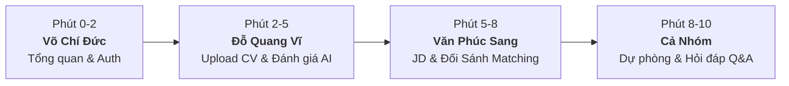

# KỊCH BẢN THUYẾT TRÌNH DEMO 10 PHÚT VÀ PHƯƠNG ÁN DỰ PHÒNG [TL-03]

**Dự án:** IT Talent AI Profile (Nhóm 10)  
**Người thực hiện:** Đỗ Quang Vĩ  
**Mã Task:** TL-03 | **Môn học:** Thực tập doanh nghiệp  
**Ngày thực hiện:** 24/11/2026 | **Phiên bản:** 1.0  
**Thời lượng demo:** 10 phút trọn vẹn  

---

### 1. DANH SÁCH TÀI NGUYÊN VÀ DỮ LIỆU DEMO ĐÃ CHUẨN BỊ

#### A. 3 File CV PDF mẫu thực tế (Lưu tại thư mục `docs/demo_samples/`)
1. `CV_Senior_Python_Backend.pdf`: Ứng viên 6 năm kinh nghiệm, kỹ năng chính Python, FastAPI, Docker, MySQL, Redis.
2. `CV_Middle_Frontend_React.pdf`: Ứng viên 3 năm kinh nghiệm, kỹ năng chính React, TypeScript, Redux, RESTful API.
3. `CV_Junior_Fullstack_Dev.pdf`: Ứng viên 1.5 năm kinh nghiệm, kỹ năng chính Node.js, Express, MongoDB, Vue.js.

*(Có thể tạo lại bất cứ lúc nào qua lệnh: `python backend/scripts/generate_demo_cvs.py`)*

#### B. 2 Tài khoản mẫu kiểm thử
* **Nhà tuyển dụng:** `hr.techcorp@example.com` (Mật khẩu: `12345678`)
* **Ứng viên:** `nguyen.senior@example.com` (Mật khẩu: `12345678`)

---

### 2. KỊCH BẢN DEMO 10 PHÚT CHI TIẾT (PHÂN VAI & THAO TÁC TỪNG PHÚT)



| Mốc thời gian | Người trình bày | Nội dung thuyết minh (Ai nói gì) | Thao tác trên màn hình (Bấm gì, xem gì) | Mục tiêu kiểm chứng |
|:---:|:---:|:---|:---|:---:|
| **00:00 - 02:00**<br>*(2 phút)* | **Võ Chí Đức**<br>*(Leader)* | "Kính chào Thầy/Cô và Hội đồng! Nhóm 10 xin trình bày dự án **IT Talent AI Profile** - Nền tảng đánh giá hồ sơ năng lực IT và đối sánh tuyển dụng tự động bằng AI. Em xin bắt đầu với luồng xác thực và phân quyền." | • Mở trình duyệt tại [http://127.0.0.1:8000/web/login.html](http://127.0.0.1:8000/web/login.html)<br>• Trình diễn tab Đăng ký / Đăng nhập.<br>• Đăng nhập tài khoản Ứng viên `nguyen.senior@example.com`. | Kiểm tra phân quyền JWT, mã hóa Bcrypt và giao diện Glassmorphism. |
| **02:00 - 05:00**<br>*(3 phút)* | **Đỗ Quang Vĩ** | "Tiếp theo, Vĩ xin demo quy trình ứng viên tải lên CV để AI tự động phân tích và lập hồ sơ năng lực 3D." | • Vào [profile.html](http://127.0.0.1:8000/web/profile.html), giới thiệu thẻ 3D Tilt Card và thanh lộ trình cấp bậc.<br>• Bấm **"📄 Tải lên CV (AI Scan)"** sang [upload_cv.html](http://127.0.0.1:8000/web/upload_cv.html).<br>• Kéo thả file `CV_Senior_Python_Backend.pdf`, bấm **Bắt đầu phân tích AI**.<br>• Hiển thị màn hình loading AI $\rightarrow$ bảng kỹ năng trích xuất $\rightarrow$ sửa thử số năm $\rightarrow$ bấm **Xác nhận lưu hồ sơ**.<br>• Sang [evaluation.html](http://127.0.0.1:8000/web/evaluation.html) xem vòng tròn điểm 85/100, cấp độ Senior và nhận định từ Claude LLM. | Kiểm tra tính năng đọc PDF, trích xuất kỹ năng, xác nhận CV và thuật toán tính điểm năng lực tự động. |
| **05:00 - 08:00**<br>*(3 phút)* | **Văn Phúc Sang** | "Sau khi ứng viên đã có hồ sơ công khai, Sang xin chuyển sang góc nhìn của Nhà tuyển dụng để tìm kiếm và đối sánh ứng viên theo JD." | • Đăng xuất, đăng nhập tài khoản NTD `hr.techcorp@example.com`.<br>• Vào [jobs.html](http://127.0.0.1:8000/web/jobs.html) xem danh sách tin tuyển dụng, demo chức năng Đóng/Mở tin.<br>• Bấm nút **"⚡ Xem Đối Sánh"** trên JD Senior Backend sang [match.html](http://127.0.0.1:8000/web/match.html).<br>• Trình diễn bảng xếp hạng AI: Ứng viên Nguyễn Văn Senior đứng Top 1 với độ khớp 96%, xem thanh tiến trình xanh lá, huy hiệu Rank #1, kỹ năng khớp (`✓ Python, ✓ MySQL`) và kỹ năng thiếu.<br>• Sang [candidates.html](http://127.0.0.1:8000/web/candidates.html) demo bộ lọc đa kỹ năng và gửi lời mời phỏng vấn. | Kiểm tra thuật toán đối sánh đa tiêu chí, lọc ẩn hồ sơ riêng tư, giao diện bảng xếp hạng và tìm kiếm. |
| **08:00 - 10:00**<br>*(2 phút)* | **Cả nhóm** | "Để đảm bảo hệ thống luôn sẵn sàng phục vụ trong môi trường doanh nghiệp thực tế, nhóm đã xây dựng phương án dự phòng khi mất kết nối mạng hoặc hết hạn mức API AI." | • Mở file `.env` hoặc terminal minh họa cơ chế `AI_MODE=mock`.<br>• Mở [http://127.0.0.1:8000/docs](http://127.0.0.1:8000/docs) chứng minh 24 API hoạt động trơn tru.<br>• Nhóm sẵn sàng lắng nghe câu hỏi đánh giá từ Hội đồng. | Thể hiện tính tin cậy, giải pháp dự phòng và hoàn thành đúng 10 phút. |

---

### 3. PHƯƠNG ÁN DỰ PHÒNG KỸ THUẬT (FALLBACK & DISASTER RECOVERY)

Khi thuyết trình trong điều kiện:
* Mất kết nối Internet hoặc mạng Wifi tại phòng bảo vệ không ổn định.
* Khóa API Claude 3.5 Sonnet bị hết hạn mức (rate limit / quota exceeded).

**Cách kích hoạt phương án dự phòng trong 5 giây:**
1. Mở file `.env` tại thư mục gốc backend (hoặc tạo file nếu chưa có):
   ```ini
   AI_MODE=mock
   AI_API_KEY=
   ```
2. Hệ thống FastAPI tự động kích hoạt bộ giả lập `MockAiClient`:
   * Vẫn đọc trọn vẹn cấu trúc file PDF CV.
   * Tự động nhận diện các từ khóa kỹ năng có trong danh mục 60 chuẩn IT.
   * Tự động sinh bản tóm tắt đánh giá năng lực tiếng Việt chuẩn UTF-8 trong vòng 0.05 giây.
   * Mọi quy trình demo vẫn diễn ra bình thường 100% không hề bị gián đoạn.
