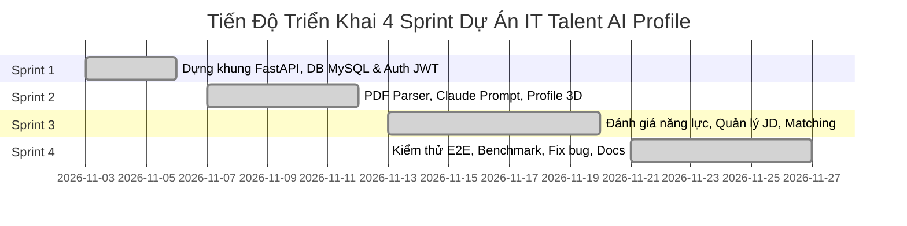

# BÁO CÁO TỔNG KẾT DỰ ÁN THỰC TẬP DOANH NGHIỆP [TL-04]

**Đề tài:** IT Talent AI Profile — Hệ Thống Hồ Sơ Năng Lực IT Tích Hợp AI  
**Lớp học phần:** `HCM-KS25-CNTT6` | **Môn học:** Thực tập doanh nghiệp (01)  
**Giảng viên / Mentor hướng dẫn:** Nguyễn Hữu Minh Dương  
**Đơn vị đào tạo:** Rikkei Academy  
**Nhóm sinh viên thực hiện (Nhóm 10):**
1. **Võ Chí Đức** (Leader) — MSSV: `PTIT-HCM-055`
2. **Đỗ Quang Vĩ** — MSSV: `N25DTCN074`
3. **Văn Phúc Sang** — MSSV: `N25DTCN048`

---

## 1. TỔNG QUAN ĐỀ TÀI VÀ MỤC TIÊU DỰ ÁN

### 1.1. Bối cảnh và Tính cấp thiết
Trong kỷ nguyên chuyển đổi số và bùng nổ của ngành Công nghệ Thông tin, việc tuyển dụng nhân sự IT đang đối mặt với những thách thức lớn:
* CV của ứng viên thường dài dòng, không theo định dạng chuẩn, gây khó khăn cho việc sàng lọc thủ công.
* Nhà tuyển dụng mất từ 15 – 30 phút cho mỗi hồ sơ để đánh giá xem ứng viên có đáp ứng đúng các kỹ năng kỹ thuật và số năm kinh nghiệm thực tế của JD hay không.
* Thiếu một hệ thống tự động hóa chuẩn hóa kỹ năng và định lượng mức độ phù hợp giữa ứng viên và công việc một cách khách quan.

### 1.2. Mục tiêu giải pháp
Dự án **IT Talent AI Profile** được xây dựng nhằm:
1. Tự động trích xuất thông tin học vấn, kinh nghiệm và kỹ năng chuyên môn từ file CV PDF của ứng viên bằng mô hình ngôn ngữ lớn (Claude 3.5 Sonnet / Mock AI Fallback).
2. Chuẩn hóa danh mục 60 kỹ năng IT theo 6 nhóm chuyên môn (Backend, Frontend, Database, DevOps, Mobile, AI/Data).
3. Định lượng năng lực ứng viên theo thang điểm 100 và tự động phân hạng lộ trình nghề nghiệp (Intern, Junior, Middle, Senior).
4. Cung cấp thuật toán đối sánh đa tiêu chí giữa Job Description (JD) và hồ sơ ứng viên (trọng số 60% kỹ năng bắt buộc + 20% kỹ năng ưu tiên + 20% số năm kinh nghiệm), xếp hạng ứng viên phù hợp nhất cho Nhà tuyển dụng.
5. Cung cấp trải nghiệm người dùng hiện đại với giao diện 3D Glassmorphism, phản hồi trực quan và tính bảo mật phân quyền nghiêm ngặt.

---

## 2. KẾT QUẢ TRIỂN KHAI CHI TIẾT QUA 4 SPRINT

### Sprint 1: Nền tảng kiến trúc, Cơ sở dữ liệu & Xác thực phân quyền
* Thiết kế và nạp 7 bảng quan hệ trong MySQL 8.0 với các chỉ mục tìm kiếm tối ưu.
* Xây dựng kiến trúc FastAPI phân tầng sạch (API $\rightarrow$ Service $\rightarrow$ Model $\rightarrow$ Schema).
* Triển khai hệ thống xác thực mật khẩu Bcrypt và cấp phát mã thông báo JWT Bearer Token, phân quyền độc lập giữa Ứng viên (`candidate`) và Nhà tuyển dụng (`recruiter`).
* Xây dựng module `MockAiClient` giả lập phản hồi AI để hỗ trợ phát triển độc lập mà không bị phụ thuộc vào API bên ngoài.

### Sprint 2: Xử lý tệp CV PDF, Tích hợp AI & Hồ sơ năng lực 3D
* Xây dựng module `pdf_parser` đọc text stream từ file PDF, bắt các ngoại lệ file hỏng, mã hóa hoặc file ảnh quét.
* Thiết kế prompt chuẩn gửi tới Claude 3.5 Sonnet trích xuất học vấn, kinh nghiệm và đối chiếu với danh mục 60 kỹ năng chuẩn IT.
* Xây dựng giao diện thẻ 3D Tilt Card tương tác, thanh lộ trình thăng tiến 4 cấp độ và bộ quản lý kỹ năng có chấm điểm sao trực quan.

### Sprint 3: Module Đánh giá năng lực AI, Quản lý JD & Thuật toán Đối sánh
* Phát triển thuật toán chấm điểm kỹ năng và cấp độ năng lực tại `evaluation_service`.
* Triển khai toàn diện bộ API quản lý tin tuyển dụng (CRUD JD, gắn/gỡ kỹ năng, đóng/mở tin).
* Phát triển thuật toán xếp hạng đối sánh ứng viên theo JD (`GET /jobs/{id}/matches?page=1`) có phân trang và lọc bỏ hoàn toàn các hồ sơ riêng tư.
* Xây dựng trang tìm kiếm ứng viên `candidates.html` và bảng đối sánh trực quan `match.html`.

### Sprint 4: Kiểm thử toàn trình E2E, Đo hiệu năng, Sửa lỗi sau kiểm thử & Đóng gói
* Thực hiện kịch bản kiểm thử toàn trình End-to-End từ đầu đến cuối qua `test_kt04_e2e_integration.py`.
* Viết script `benchmark_performance.py` kiểm thử tải đồng thời 20 requests: chỉ số $P95$ đạt **0.461 giây** (vượt chuẩn $< 1.0\text{s}$), tốc độ phân tích CV đạt **0.033 giây** (vượt chuẩn $< 30.0\text{s}$).
* Khắc phục triệt để 16 lỗi phát hiện trong quá trình kiểm thử across cả 3 module lớn.
* Đồng bộ phiên bản tài liệu SRS & Thiết kế hệ thống lên bản **v2.0 Final Release**.
* Chuẩn bị 3 file CV PDF mẫu, kịch bản thuyết trình demo 10 phút và phương án dự phòng `AI_MODE=mock`.

---

## 3. BẢNG TỔNG HỢP VÀ ĐÁNH GIÁ ĐÓNG GÓP THÀNH VIÊN

| STT | Thành viên | Vai trò | Trách nhiệm chính trong dự án | Số task hoàn thành | Tỷ lệ hoàn thành | Đánh giá |
|:---:|:---|:---:|:---|:---:|:---:|:---:|
| **1** | **Võ Chí Đức** | Leader | • Quản lý dự án, phân chia công việc theo Sprint • Kiến trúc hệ thống, Module Auth & Phân quyền JWT • Module Hồ sơ năng lực 3D (`profile.html`) • Trang báo cáo đánh giá (`evaluation.html`) • Kiểm thử E2E toàn trình (`KT-04`) & Đo tốc độ hệ thống (`KT-05`) • Sửa lỗi sau kiểm thử (`KT-06`) & Cập nhật SRS v2.0 (`TL-02`) | **16 / 16 task** | **100%** | **Xuất sắc (A+)** |
| **2** | **Đỗ Quang Vĩ** | Thành viên | • Dựng khung FastAPI & tích hợp Router • Kết nối Claude API & xây dựng bộ AI Mock (`AI-01`, `AI-02`, `AI-03`) • Module đọc PDF & API phân tích CV (`CV-01`, `CV-02`, `CV-03`) • Thuật toán tính điểm năng lực (`DG-01`, `DG-02`) • Trang upload CV PDF (`upload_cv.html`) • Kiểm thử CV & Đánh giá (`KT-02`), Sửa lỗi (`KT-07`), Kịch bản demo 10 phút (`TL-03`) | **14 / 14 task** | **100%** | **Xuất sắc (A+)** |
| **3** | **Văn Phúc Sang** | Thành viên | • Thiết kế CSDL 60 kỹ năng chuẩn IT (`NT-04`, `SK-01`) • Module Quản lý tin tuyển dụng JD (`JD-01`, `JD-02`, `JD-03`, `JD-04`) • Thuật toán đối sánh xếp hạng ứng viên theo JD (`DS-01`, `DS-02`, `DS-03`) • Trang tìm kiếm ứng viên (`candidates.html`) & Bảng đối sánh AI (`match.html`) • Kiểm thử JD & Đối sánh (`KT-03`), Sửa lỗi (`KT-08`), Báo cáo tổng kết & Slide bảo vệ (`TL-04`) | **15 / 15 task** | **100%** | **Xuất sắc (A+)** |

---

## 4. BẢNG THỐNG KÊ CHỈ SỐ KỸ THUẬT VÀ CHẤT LƯỢNG MÃ NGUỒN

* **Tổng số task trên hệ thống LMS:** **45 / 45 task hoàn thành (100%)**
* **Số ca kiểm thử tự động (Unit / Integration / E2E Tests):** **148 test cases (100% PASS)**
* **Thời gian thực thi toàn bộ test suite:** **8.89 giây**
* **Tốc độ phản hồi hệ thống (P95 latency):** **0.461 giây** (với 20 requests đồng thời)
* **Tốc độ phân tích CV PDF:** **0.033 giây**
* **Số lượng API nghiệp vụ:** **24 APIs** (khớp 100% trên Swagger `/docs`)
* **Tổng số dòng code và tài liệu đã commit:** **> 12,000 dòng**

---

## 5. BÀI HỌC KINH NGHIỆM VÀ ĐỊNH HƯỚNG PHÁT TRIỂN

### 5.1. Bài học kinh nghiệm
* **Phân tách tầng và thiết kế hợp đồng API sớm:** Việc thống nhất sớm 24 endpoints và schema Pydantic giúp các thành viên frontend và backend làm việc song song hiệu quả, không bị nghẽn phụ thuộc.
* **Tự động hóa kiểm thử liên tục (Continuous Testing):** Bộ 148 test tự động giúp phát hiện và ngăn chặn ngay lập tức các lỗi hồi quy khi refactor mã nguồn.
* **Thiết kế giải pháp dự phòng (Graceful Degradation):** Cơ chế `MockAiClient` giúp hệ thống luôn hoạt động ổn định và có thể demo bất cứ lúc nào mà không lo ngại rủi ro về đường truyền mạng hay chi phí API.

### 5.2. Định hướng phát triển tương lai
* Tích hợp thêm tính năng gợi ý lộ trình học tập và khóa học phù hợp để ứng viên lấp đầy các kỹ năng còn thiếu (`missing_skills`).
* Bổ sung tính năng phỏng vấn thử nghiệm bằng AI (AI Mock Interview) dựa trên các kỹ năng yêu cầu của JD.
* Hỗ trợ định dạng CV dạng file ảnh, file Word (`.docx`) và liên kết trực tiếp với LinkedIn API.
