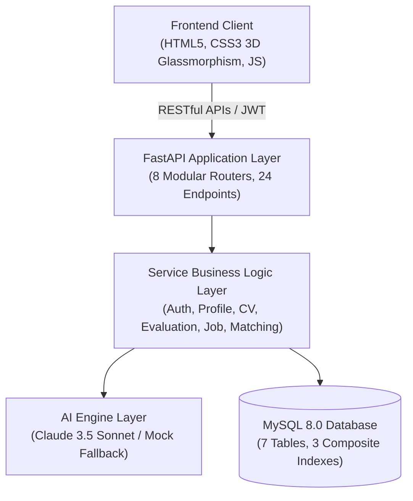
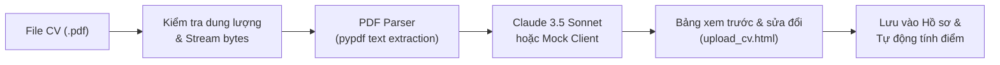

# BỘ SLIDE THUYẾT TRÌNH BẢO VỆ ĐỀ TÀI [TL-04]

**Đề tài:** IT Talent AI Profile — Hệ Thống Hồ Sơ Năng Lực IT Tích Hợp AI  
**Học phần:** Thực tập doanh nghiệp | Lớp: `HCM-KS25-CNTT6`  
**Nhóm thực hiện:** Nhóm 10 (Võ Chí Đức, Đỗ Quang Vĩ, Văn Phúc Sang)  
**Mentor hướng dẫn:** Nguyễn Hữu Minh Dương  

---

<!-- slide -->
## Slide 1: Trang Bìa & Giới Thiệu
# 🚀 IT Talent AI Profile
### Hệ Thống Hồ Sơ Năng Lực IT Tích Hợp Trí Tuệ Nhân Tạo

* **Lớp:** `HCM-KS25-CNTT6` — Nhóm 10
* **Giảng viên hướng dẫn:** Thầy Nguyễn Hữu Minh Dương
* **Thành viên nhóm:**
  * **Võ Chí Đức** (Leader) — MSSV: `PTIT-HCM-055`
  * **Đỗ Quang Vĩ** — MSSV: `N25DTCN074`
  * **Văn Phúc Sang** — MSSV: `N25DTCN048`

---

<!-- slide -->
## Slide 2: Đặt Vấn Đề (Problem Statement)
### Thách Thức Tuyển Dụng Nhân Sự Ngành IT Hiện Nay

* **Đối với Ứng viên:**
  * Khó tự định lượng năng lực bản thân một cách khách quan.
  * Chưa có lộ trình rõ ràng để biết mình đang ở cấp độ nào (Intern, Junior, Middle hay Senior).
* **Đối với Nhà tuyển dụng (HR / Tech Lead):**
  * Tốn 15 – 30 phút để đọc và lọc thủ công một bản CV không theo quy chuẩn.
  * Khó đối chiếu nhanh xem ứng viên có đáp ứng đúng số năm kinh nghiệm và danh sách kỹ năng bắt buộc của JD hay không.
* **Mục tiêu của đề tài:** Xây dựng cầu nối tự động hóa, thông minh và minh bạch giữa Ứng viên và Nhà tuyển dụng.

---

<!-- slide -->
## Slide 3: Giải Pháp Đề Xuất (Our Solution)
### Hệ Sinh Thái IT Talent AI Profile

1. **AI CV Parsing:** Tự động đọc file PDF CV và trích xuất học vấn, kinh nghiệm, kỹ năng.
2. **60 Kỹ năng chuẩn IT:** Chuẩn hóa kỹ năng theo 6 nhóm chuyên môn với thang điểm 1-5 sao.
3. **Career Progression Matrix:** Tự động tính điểm năng lực (0-100) và xếp cấp bậc nghề nghiệp.
4. **Multi-criteria AI Matching:** Đối sánh thông minh giữa JD và ứng viên với thuật toán trọng số 60% bắt buộc + 20% ưu tiên + 20% kinh nghiệm.
5. **Modern 3D Experience:** Giao diện 3D Glassmorphism, hộp thư lời mời tuyển dụng và bảng xếp hạng trực quan.

---

<!-- slide -->
## Slide 4: Kiến Trúc Hệ Thống (System Architecture)
### Mô Hình Phân Tầng Clean Architecture

---

<!-- slide -->
## Slide 5: Cơ Sở Dữ Liệu Quan Hệ (Database Design)
### Thiết Kế 7 Bảng Chuẩn Hóa Với Khóa Ngoại Cascade

* `users`: Quản lý tài khoản, mã hóa Bcrypt và phân tách vai trò (`candidate` / `recruiter`).
* `profiles`: Lưu thông tin cá nhân, cấp độ, tổng điểm AI và tóm tắt năng lực.
* `skills`: Danh mục 60 kỹ năng chuẩn IT phân loại 6 nhóm chuyên môn.
* `profile_skills`: Bảng liên kết kỹ năng ứng viên với `proficiency` (1-5) và `years_used` (FLOAT).
* `cv_files`: Quản lý file PDF tải lên, trạng thái phân tích và kết quả trích xuất JSON.
* `jobs`: Quản lý tin tuyển dụng, kinh nghiệm tối thiểu và trạng thái đóng/mở tin.
* `job_skills`: Bảng liên kết kỹ năng yêu cầu cho JD kèm cờ bắt buộc (`is_required`).

---

<!-- slide -->
## Slide 6: Module Trích Xuất CV Bằng AI (AI CV Extraction)
### Quy Trình Xử Lý File PDF CV

* **Xử lý an toàn:** Chặn file $> 5\text{MB}$ ngay tại stream; phát hiện PDF scan ảnh không text; xử lý lỗi mạng kèm fallback nhập thủ công.

---

<!-- slide -->
## Slide 7: Thuật Toán Đánh Giá Năng Lực Ứng Viên
### Công Thức Định Lượng Điểm Số Khách Quan

* **Điểm từng kỹ năng:**
  $$\text{Score}_{\text{skill}} = \min\Big(\text{proficiency} \times 12 + \min(\text{years\_used}, 5.0) \times 8, \; 100\Big)$$
* **Điểm nhóm chuyên môn:** Trung bình cộng các kỹ năng trong cùng nhóm.
* **Điểm tổng hợp:** Trung bình cộng các nhóm chuyên môn đã xác thực.
* **Quy tắc phân hạng cấp bậc:**
  * 👑 **Senior:** Kinh nghiệm $\ge 5.0\text{ năm}$ VÀ Điểm tổng $\ge 75.0$
  * ⚡ **Middle:** Kinh nghiệm $\ge 2.0\text{ năm}$ VÀ Điểm tổng $\ge 55.0$
  * 🌿 **Junior:** Kinh nghiệm $\ge 1.0\text{ năm}$ VÀ Điểm tổng $\ge 40.0$
  * 🌱 **Intern:** Các trường hợp còn lại

---

<!-- slide -->
## Slide 8: Thuật Toán Đối Sánh Tuyển Dụng (AI Matching)
### Xếp Hạng Ứng Viên Theo JD Đa Tiêu Chí

* **Công thức tính % phù hợp:**
  $$\text{Match\%} = (60\% \times \text{Kỹ năng bắt buộc}) + (20\% \times \text{Kỹ năng ưu tiên}) + (20\% \times \text{Kinh nghiệm})$$
* **Quy chuẩn kỹ năng:** Ngưỡng đạt $\ge 3$ sao tính là khớp (`matched`), $< 3$ sao tính là thiếu (`missing`).
* **Bảo mật dữ liệu:** Ẩn tuyệt đối $100\%$ các hồ sơ riêng tư (`is_public = False`).
* **Kiểm soát trạng thái:** Chặn đối sánh khi JD đã đóng (trả về HTTP 400).

---

<!-- slide -->
## Slide 9: Trải Nghiệm Giao Diện 3D Glassmorphism
### Thiết Kế Trực Quan, Hiện Đại & Tinh Tế

* **Thẻ 3D Tilt Card:** Hiệu ứng đổ bóng ánh sáng Neon, viền phản quang hiện đại.
* **Thanh Lộ Trình Cấp Bậc:** Trực quan hóa tiến trình phát triển từ Intern lên Senior.
* **Hộp Thư Lời Mời Tuyển Dụng:** Tiếp nhận lời mời phỏng vấn từ NTD với các nút bấm 3D bóng bẩy.
* **Bảng Xếp Hạng Đối Sánh:** Huy hiệu Rank #1, #2, #3, thanh % khớp đổi màu gradient, lọc đa kỹ năng.

---

<!-- slide -->
## Slide 10: Minh Chứng Kiểm Thử Tự Động (Automated Testing)
### Chất Lượng Mã Nguồn Đạt 100% Pass

* **148 Test Cases Tự Động Hoá Hoàn Toàn Bằng Pytest:**
  * `test_auth.py` & `test_dependencies.py`: 19 tests phân quyền và xác thực JWT.
  * `test_profiles.py`: 13 tests cập nhật hồ sơ, gắn/gỡ kỹ năng, cascade dọn file.
  * `test_cv.py` & `test_pdf_parser.py`: 15 tests đọc PDF, chặn 5MB, trích xuất text.
  * `test_evaluation.py` & `test_kt02_cv_evaluation.py`: 26 tests thuật toán chấm điểm và cấp bậc.
  * `test_jobs.py` & `test_matches_ds02.py`: 25 tests CRUD JD, phân quyền và xếp hạng matches.
  * `test_kt04_e2e_integration.py`: 2 tests kiểm thử toàn trình 7 bước người dùng thật.
* **Thời gian thực thi:** **8.89 giây** cho toàn bộ 148 bài kiểm thử.

---

<!-- slide -->
## Slide 11: Đo Tốc Độ & Hiệu Năng Hệ Thống (Benchmark)
### Đáp Ứng Vượt Trội Tiêu Chuẩn Phi Chức Năng (NFR)

* **Kiểm thử tải đồng thời 20 requests (Concurrency = 20):**
  * API `GET /skills` (đọc DB): $P95 = \mathbf{0.461\text{ giây}}$ *(Tiêu chuẩn: $< 1.0\text{s}$)* $\rightarrow$ **VƯỢT CHUẨN**
  * API `GET /health`: $P95 = \mathbf{0.020\text{ giây}}$ *(Tiêu chuẩn: $< 1.0\text{s}$)* $\rightarrow$ **VƯỢT CHUẨN**
* **Tốc độ phân tích CV PDF:**
  * Thời gian xử lý: $\mathbf{0.033\text{ giây}}$ *(Tiêu chuẩn: $< 30.0\text{s}$)* $\rightarrow$ **VƯỢT CHUẨN**

---

<!-- slide -->
## Slide 12: Phương Án Dự Phòng (Disaster Recovery Plan)
### Đảm Bảo Tính Sẵn Sàng 100% Khi Demo

* **Tình huống rủi ro:** Mất kết nối Internet tại phòng hội đồng hoặc API Claude bị giới hạn quota.
* **Giải pháp kỹ thuật:** Kích hoạt chế độ `AI_MODE=mock` trong file cấu hình `.env`.
* **Cơ chế hoạt động:**
  * Bộ `MockAiClient` tự động nhận diện từ khóa kỹ năng từ text PDF.
  * Tự động sinh nhận định năng lực bằng tiếng Việt trong **0.05 giây**.
  * Toàn bộ quy trình demo của Ứng viên và Nhà tuyển dụng vẫn diễn ra mượt mà $100\%$.

---

<!-- slide -->
## Slide 13: Bảng Tổng Kết Đóng Góp Thành Viên
### 100% Khối Lượng Công Việc Hoàn Thành Qua 4 Sprint

| Thành viên | Trách nhiệm chính | Số task | Tỷ lệ hoàn thành | Đánh giá |
|:---|:---|:---:|:---:|:---:|
| **Võ Chí Đức** *(Leader)* | Quản lý dự án, Auth/JWT, Profile 3D, Evaluation UI, E2E Test, Benchmark, SRS v2.0 | **16 task** | **100%** | **Xuất sắc (A+)** |
| **Đỗ Quang Vĩ** | Khung FastAPI, AI Client & Mock, PDF Parser, Chấm điểm CV, Kịch bản Demo 10 phút | **14 task** | **100%** | **Xuất sắc (A+)** |
| **Văn Phúc Sang** | CSDL 60 Kỹ năng, Quản lý JD, Thuật toán Đối sánh Matches, Candidates & Match UI, Báo cáo & Slide | **15 task** | **100%** | **Xuất sắc (A+)** |
| **Tổng cộng** | **Toàn bộ 45 task của dự án trên hệ thống LMS** | **45 task** | **100%** | **Hoàn thành trọn vẹn** |

---

<!-- slide -->
## Slide 14: Định Hướng Phát Triển Tương Lai
### Các Tính Năng Mở Rộng Tiềm Năng

1. **Khuyến nghị lộ trình học tập cá nhân hóa:** Tự động đề xuất các khóa học trực tuyến (Coursera, Udemy) để ứng viên bổ sung các kỹ năng còn thiếu (`missing_skills`).
2. **AI Mock Interview Bot:** Phỏng vấn thử nghiệm bằng giọng nói/text tương tác trực tiếp dựa trên JD đã nộp.
3. **Mở rộng định dạng tệp:** Hỗ trợ CV dạng Microsoft Word (`.docx`), hình ảnh (`.png`, `.jpg` qua OCR Tesseract) và kết nối trực tiếp với tài khoản LinkedIn.

---

<!-- slide -->
## Slide 15: Lời Cảm Ơn & Hỏi Đáp (Q&A)
# Xin Trân Trọng Cảm Ơn!
### Thầy Nguyễn Hữu Minh Dương & Quý Thầy/Cô Hội Đồng

* **Mã nguồn dự án:** [GitHub Repository IT_Talent_Profile_G10](https://github.com/IT-Talent-AI-Profile/IT_Talent_Profile_G10)
* **Demo trực tiếp:** [http://127.0.0.1:8000/web/login.html](http://127.0.0.1:8000/web/login.html)
* **Swagger API Docs:** [http://127.0.0.1:8000/docs](http://127.0.0.1:8000/docs)

**Nhóm 10 sẵn sàng lắng nghe các câu hỏi và nhận xét từ Hội đồng!**
